# Ticketmaster en AWS: web con alta disponibilidad

Trabajo final del curso **Arquitectura de Computadoras y Sistemas Operativos** (UPC, 2026-1). Trabajo grupal de 3 integrantes. El sitio de prueba ya no está en línea.

## El problema

En la preventa de "The Eras Tour" (2022), Ticketmaster esperaba cerca de 1,5 millones de usuarios y más de 14 millones intentaron entrar a la vez, según reportó CNBC (2023). El resultado fueron colas virtuales, errores de acceso y caídas. El trabajo propone una arquitectura en AWS que aguante picos de tráfico así.

## La solución

El tráfico entra por un balanceador de carga que lo reparte entre varios servidores web en zonas de disponibilidad distintas. La base de datos va separada de los servidores web, en una subred privada.

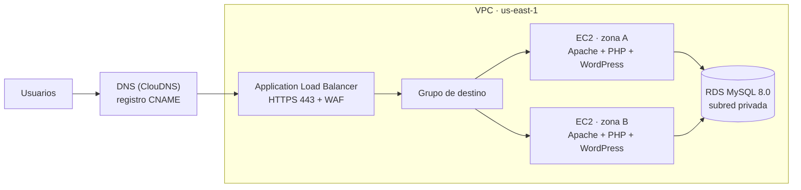

| Capa | Servicio | Detalle |
|---|---|---|
| DNS | ClouDNS (zona gratuita) | Registro CNAME hacia el DNS público de la instancia EC2 |
| Balanceador | Application Load Balancer | Escucha HTTPS en el puerto 443, con subredes en todas las zonas de disponibilidad de la región y un WAF predeterminado |
| Certificado | Let's Encrypt (Certbot) | Se genera en la instancia y se importa a ACM para usarlo en el balanceador |
| Cómputo | EC2 con Ubuntu Server LTS | Apache, PHP y WordPress; el segundo servidor se creó a partir de una AMI del primero |
| Base de datos | RDS MySQL 8.0 | Cifrada, sin acceso público y con credenciales en Secrets Manager |
| Red | VPC por defecto y security groups | Un grupo para los servidores web y otro para la base de datos |

## Diseño propuesto vs. despliegue de prueba

El informe plantea un diseño de producción. Lo que se levantó para la prueba fue una versión más pequeña:

| | Diseño del informe | Despliegue de prueba |
|---|---|---|
| Región | us-west-2 (Oregón) | us-east-1 (N. Virginia) |
| Servidores web | 4 × m6i.large | 2 instancias (m6i.large y t2.micro) en zonas de disponibilidad distintas |
| Base de datos | db.r6i.large, Multi-AZ | db.t4g.micro, una sola zona de disponibilidad (entorno de pruebas) |
| Balanceador y HTTPS | ALB con HTTPS | ALB con HTTPS y WAF |

## Costo estimado del diseño

| Recurso | Costo mensual (USD) |
|---|---|
| 4 × EC2 m6i.large (720 h) + 30 GB gp3 | 278,88 |
| RDS db.r6i.large + 100 GB gp3 | 180,80 |
| **Total del informe (incluye el balanceador)** | **478,88** |

## Cómo se montó

1. Crear los security groups, la instancia EC2 y la base de datos RDS (MySQL 8.0, sin acceso público y conectada a la instancia).
2. Entrar por SSH a la instancia e instalar la pila web y WordPress:

```bash
sudo apt install apache2 php php-mysqlnd -y
wget https://wordpress.org/latest.tar.gz
tar -xzf latest.tar.gz
nano wordpress/wp-config.php        # datos de la base de datos RDS y claves únicas
sudo cp -r wordpress/* /var/www/html/
sudo rm /var/www/html/index.html
```

3. Crear la zona en ClouDNS y un registro CNAME hacia la instancia.
4. Emitir el certificado con Certbot (`sudo certbot --apache`).
5. Crear una AMI de la instancia y lanzar un segundo servidor desde ella.
6. Crear el grupo de destino, registrar las dos instancias y crear el Application Load Balancer con listener HTTPS (certificado importado a ACM) y WAF.

## Capturas del despliegue

Capturas de la consola de AWS durante la prueba, recortadas para no mostrar credenciales ni datos de la cuenta.

**1. Creación de la instancia EC2: nombre e imagen (Ubuntu Server).**

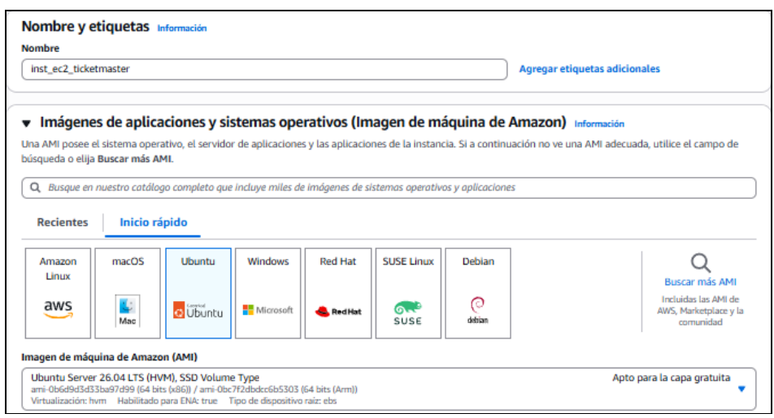

**2. Tipo de instancia, par de claves, red y security group.**

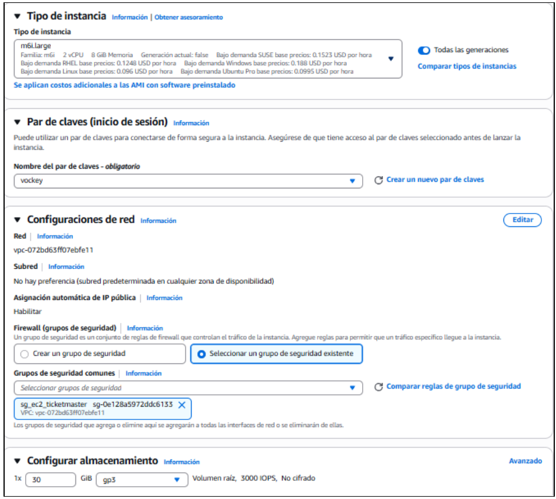

**3. Creación de la base de datos RDS (MySQL) con las credenciales en Secrets Manager.**

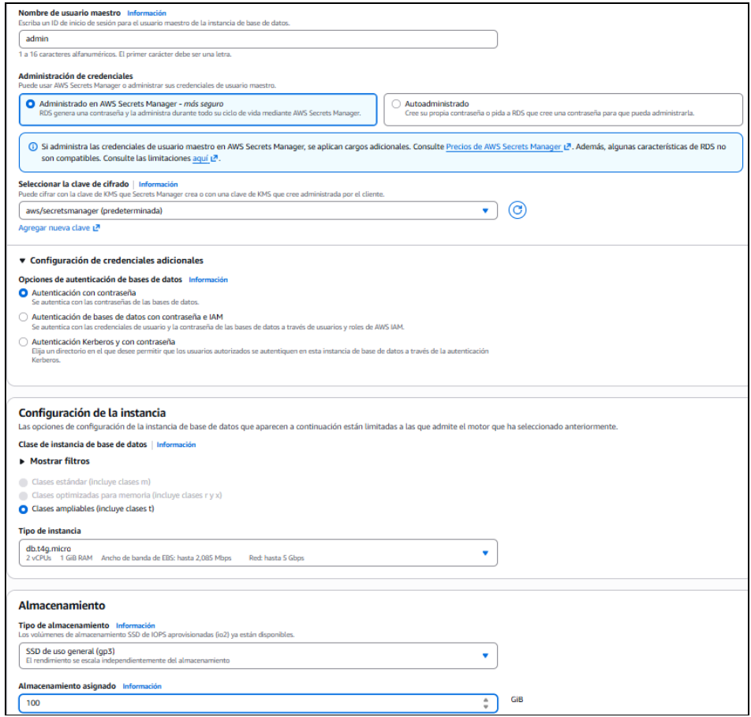

**4. Conexión de la base de datos con la instancia EC2.**

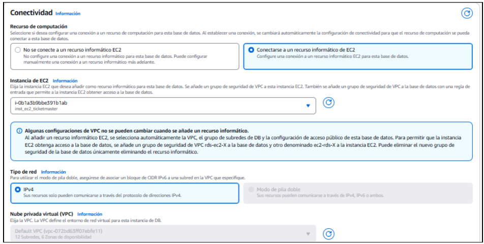

**5. Base en subred privada, sin acceso público y con su propio security group.**

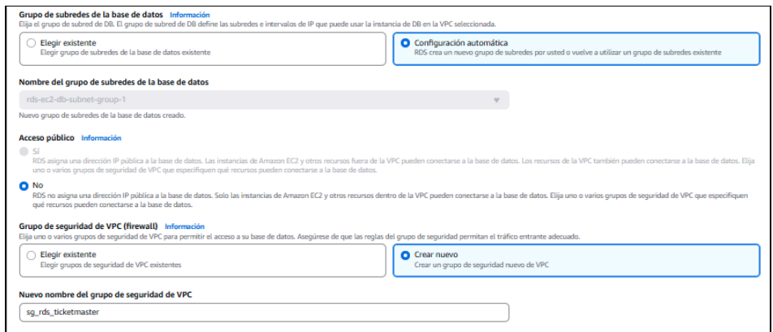

**6. Registro CNAME en ClouDNS hacia la instancia.**

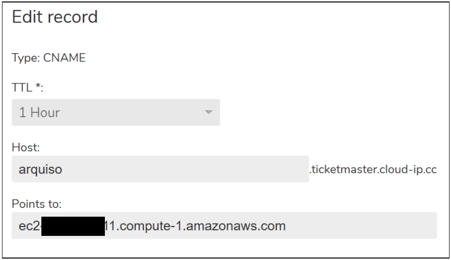

**7. Emisión del certificado con Certbot.**

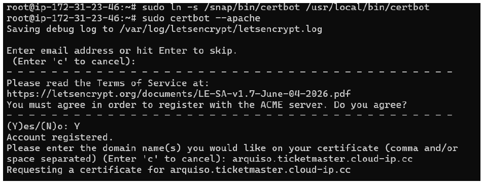

**8. El sitio con HTTPS activo.**

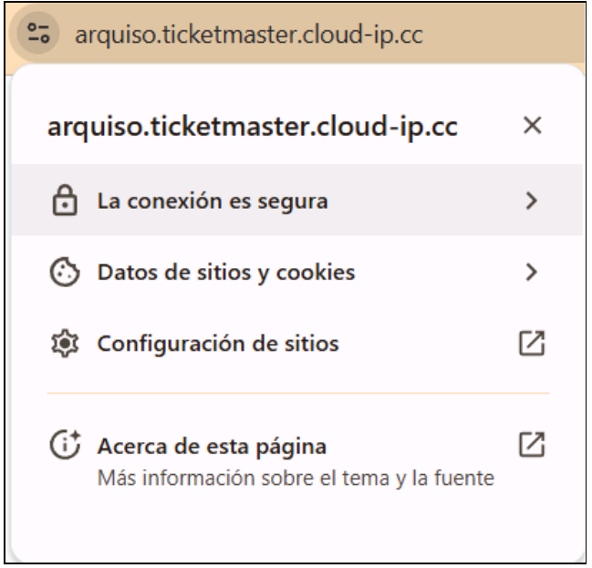

**9. Creación de la AMI para clonar el servidor.**

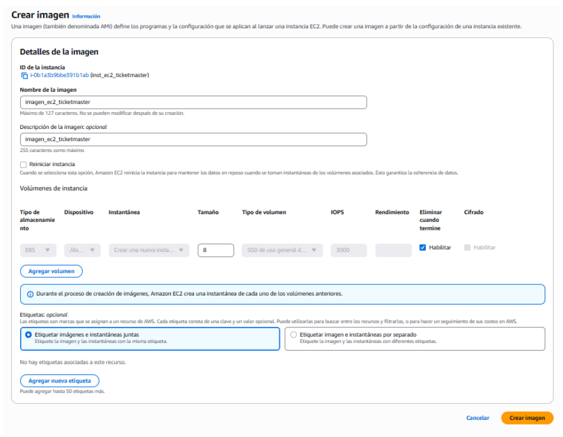

**10. Balanceador de carga: zonas de disponibilidad y subredes.**

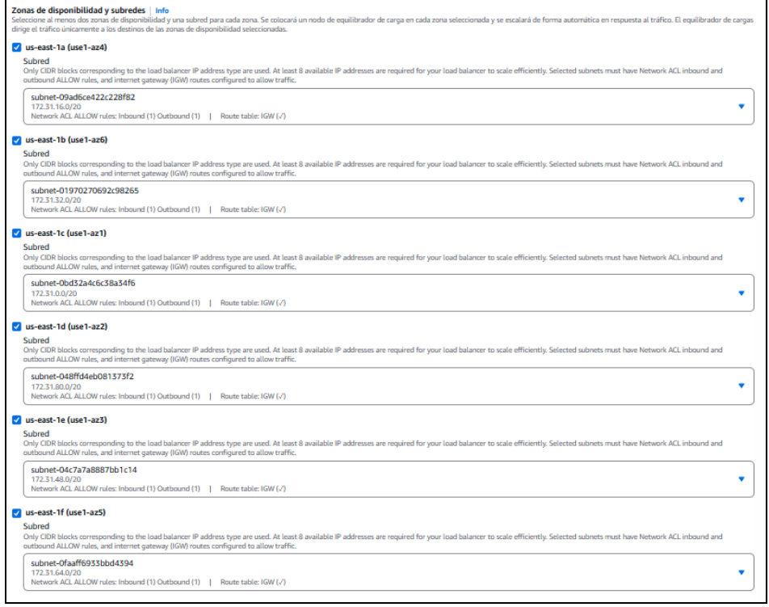

**11. Listener HTTPS 443 y security group del balanceador.**

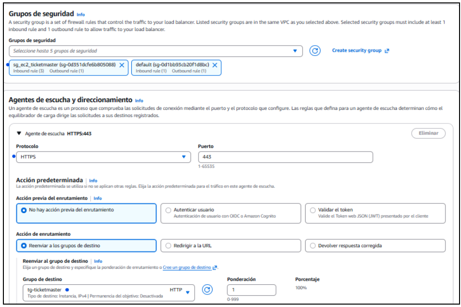

**12. Grupo de destino con las 2 instancias en buen estado (Healthy), en us-east-1a y us-east-1e.**

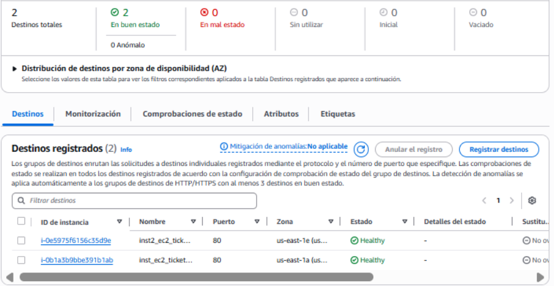

## Mi aporte

Hice el trabajo de principio a fin: elegí y dimensioné los recursos, levanté la instancia EC2 y la base de datos RDS, instalé Apache, PHP y WordPress, configuré el DNS y el certificado HTTPS, creé la AMI para clonar el servidor y armé el balanceador de carga con el grupo de destino. También redacté el informe.

## Mejoras pendientes

- Activar Multi-AZ en la base de datos de la versión desplegada.
- Auto Scaling Group para ajustar el número de servidores a la demanda.
- Backups automáticos de RDS y de los archivos del sitio (S3), en otra región.
- Alarmas de CloudWatch y pruebas periódicas de tolerancia a fallos.
- Instancias reservadas o planes de ahorro para reducir el costo.

## Nota sobre credenciales

Las capturas están recortadas. No publico las que mostraban contraseñas, claves del certificado o el identificador de la cuenta de AWS, y en este repositorio no hay ninguna credencial.
